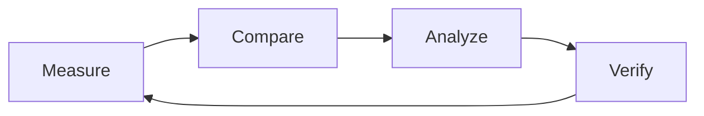

# MoonPerf Lab

**Reproducible performance research for MoonBit.**

MoonPerf Lab is a MoonBit-first experiment platform for the MoonBit ecosystem.
It starts from cross-language performance comparison, and its core value is an
optimization gain you can verify: establishing baselines, running controlled
experiments, locating where MoonBit programs lose time, and proving that a
change actually helps — on another machine, by another person, from the
recorded evidence.

The target framework core is a MoonBit program. The programs under test are
MoonBit, Rust, C or anything else. Moonlake is the first real validation case,
not the owner of the project.

It is not a benchmark collection and not a performance-analysis product. It is
the experiment infrastructure that makes performance claims checkable.

## The loop



## What it answers

- How does a MoonBit program behave under a given workload?
- Where does the gap to a Rust or C reference come from: algorithm, data
  layout, compiler decisions, memory access or runtime overhead?
- Which gaps can be closed by changing the code, the layout or the algorithm?
- Does an optimization replicate on another machine, and is the gain larger
  than the measurement noise?
- Which results can be reused as benchmarks, methods or tools by the rest of
  the MoonBit ecosystem?

The last question is the point of the project. A single ratio between two
languages is not a result; a reproducible experiment that explains it is.

## Scope in three layers

| Layer | What it adds | Horizon |
| --- | --- | --- |
| **L1 · Measurement infrastructure** | Unified workload definitions, MoonBit-owned run flow, environment capture, result format and a reproduction path: performance data you can trust and repeat. | MVP |
| **L2 · Cross-language research** | The same workload and semantics implemented in MoonBit, Rust and, later, C, so differences can be attributed to algorithms, compilers, memory access and runtime behaviour. | Mid-term |
| **L3 · Optimization and knowledge** | Reusable baselines, regression detection, profiling and attribution, cross-project adapters and published evidence that turns experiments into optimization practice. | Long-term |

The layers are built in that order on purpose. A comparison is only worth
making once the measurement is trustworthy; an optimization is only worth
reporting once it can be reproduced.

## MoonBit-first

"MoonBit-first" is an architecture rule, not a line-count target.

- The **framework core** — experiment model, manifest parsing, dataset
  generation, process orchestration, correctness, statistics, result handling,
  report generation and workflow orchestration — is MoonBit in the target
  architecture.
- **Rust, C and other languages** are for implementations under test,
  reference implementations and a minimal OS adapter. They do not own the
  experiment loop.
- The P1 runtime path will have **no Python**. The current Python harness is a
  temporary oracle for the port; it is frozen and will move out of the runtime
  path.
- The evidence for MoonBit-first is the **capability ownership matrix** in
  [`docs/architecture.md`](docs/architecture.md), plus `moon test` and a CLI
  built by the MoonBit toolchain. Padding line counts is explicitly not a goal.
- A non-MoonBit component must justify itself by a missing OS primitive, a
  workload subject, a build tool or the temporary oracle. Its interface and
  limits are in [`docs/implementation-boundaries.md`](docs/implementation-boundaries.md).

## What it is not

| Not this | Why |
| --- | --- |
| A pile of benchmark results | Numbers without reproducible infrastructure, correctness gates and an optimization loop are not evidence. |
| A Moonlake-only tool | Moonlake is the first real workload and the first dogfooding case, not the boundary of the lab. |
| A language leaderboard | One number per language hides the workload and the measurement conditions. |
| A replacement for profilers | The lab integrates existing profilers and hardware counters instead of building another sampling engine. |
| An "AI that optimizes everything" | Automation can be added incrementally; it cannot replace experimental design and verification. |

## Mission and vision

**Mission.** Make performance measurement in the MoonBit ecosystem
reproducible, performance gaps analyzable and optimization gains verifiable.

**Vision.** A credible, open and sustainable performance research
infrastructure for MoonBit, where optimization moves from intuition to
evidence.

## Design goals

- **Trust.** A result can be reproduced from its artifact by someone who was
  not present when it was produced.
- **Comparability.** The same workload, dataset and measurement rules apply to
  every implementation in a table.
- **Traceability.** Every number links to a commit, a toolchain and a dataset
  hash.
- **Low integration cost.** A new workload or language is a directory, not a
  framework change.
- **Honesty.** The lab can report a loss, a tie or an unstable measurement, and
  it says so explicitly.

## Principles

> Reproducible by default. Comparable by design. Optimizable in practice.

- **MoonBit owns the experiment.** The framework core is MoonBit in the target
  architecture; the subjects may be anything. A Python or shell framework is
  not an acceptable end state.
- **Correctness gates performance.** An implementation that produces the wrong
  answer is a bug report, not a fast result. It is never timed, ranked or
  quoted.
- **No predetermined winner.** The lab must be able to report that MoonBit is
  faster, equal or slower. A conclusion that cannot come out either way is
  marketing, not research.
- **Every claim has an artifact.** A result is a JSON file with raw samples,
  environment metadata, the correctness verdict and the command that produced
  it. The Markdown report is generated from that file.
- **Separate the framework from the subject.** Harness scheduling is outside
  the timed region; process startup and dataset loading are measured, recorded
  and kept small relative to the kernel. They are not hidden.
- **Integrate, don't reinvent.** Use the compilers, profilers and counters that
  already exist. Add a MoonBit dependency only with a concrete need.
- **Small and honest beats broad and noisy.** One workload measured properly is
  worth more than ten measured carelessly.

## Hackathon context

This repository is developed for the MoonBit hackathon. The verified rule
snapshot available here is the **2026-09 official material** (archived
2026-09-04; deadline extension to 2026-09-30 communicated on 2026-09-22). The
formal charter is behind a login wall; the official site says the formal
charter and official notices prevail.

The rule that shapes this repository is: **MoonBit is the primary
implementation language.** It is a qualitative requirement, not a line-count
ratio. The project answers it with a MoonBit framework core and a capability
ownership matrix, not padding.

The 2026-09 material does **not** list CI, mooncakes publication, a minimum
commit count or a 4k–10k line target as acceptance gates. They are quality
signals. For a later monthly round, re-verify the current charter and deadline
in the event group; this repository does not assume an October rule set.

## Status

**P0 is in place.** The experiment protocol, the workload, adapter and result
schemas, the workload skeleton, a Python validation harness and a MoonBit
capability audit are in this repository. The schemas and the CLI are enforced
by tests and CI, so the protocol already has teeth.

**P1 is in progress, not accepted.** P1.0-A fixed the two blocking runner
defects with regression tests and produced a temporary `ok` oracle artifact at
`K = 50` (CV 2.07 % Rust, 2.36 % MoonBit) under ignored `results/tmp/`. It is
not an artifact of record: the build was incremental, the setup baseline and
optimizer-elimination checks are still missing, and the MoonBit core has not
been started. The current framework is Python; this is the architecture gap the
MVP closes.

**No performance numbers are published yet, and there is no leaderboard.** The
first complete experiment — `numeric-scan` in MoonBit and Rust on a recorded
host — is P1. A valid result is a JSON artifact with raw samples, a correctness
verdict, environment metadata and a reproduction command; no such artifact
exists yet.

What exists today:

| Asset | State |
| --- | --- |
| [`docs/experiment-protocol.md`](docs/experiment-protocol.md) | Normative contract for a measurement, from dataset bytes to result artifact |
| [`schemas/`](schemas/) | JSON Schema for workload manifests, adapters and result artifacts |
| [`workloads/numeric-scan/`](workloads/numeric-scan/) | First workload, specified; MoonBit and Rust implementations drafted |
| [`mpf/`](mpf/) | Python bootstrap: `list`, `validate`, and a runner/report draft |
| [`tests/`](tests/) | 47 Python tests for the specification and runner fixtures |
| [`docs/ROADMAP.md`](docs/ROADMAP.md) | Phases, status, gaps, risks and acceptance |
| [`docs/architecture.md`](docs/architecture.md) | MoonBit-first target architecture and verified capabilities |
| [`docs/mvp.md`](docs/mvp.md) | MVP scope, acceptance tests and out-of-scope list |
| [`docs/implementation-boundaries.md`](docs/implementation-boundaries.md) | What belongs in MoonBit core, adapters, host scripts and dependencies |

The Python runner draft is **not** an accepted part of the architecture. It is
kept as an oracle for the MoonBit port. Do not add new experiment features to
it; see [`docs/ROADMAP.md`](docs/ROADMAP.md#p10-freeze-the-oracle-and-prove-the-host).

## Target architecture at a glance

```text
MoonBit core (moonperf/)
  manifest -> dataset -> host calls -> correctness -> measurement
           -> artifact JSON -> Markdown report
        |
        +-- host primitive: process group, timeout, wall clock
        +-- workloads/<name>/implementations/<id>: MoonBit, Rust, C
        +-- schemas/: the normative artifact and manifest contract
```

The host primitive is the only non-MoonBit component in the framework runtime
path; on Linux MVP it is the `setsid`/`kill` utility pair, replaceable by a
small native shim.
Implementations under test are separate programs. Details:
[`docs/architecture.md`](docs/architecture.md).

## Repository layout

```text
docs/
  experiment-protocol.md       normative protocol: what a valid experiment is
  ROADMAP.md                   phases, status, gaps, risks and acceptance
  architecture.md              MoonBit-first target architecture
  mvp.md                       MVP specification and acceptance tests
  implementation-boundaries.md what belongs where, and what may be non-MoonBit
schemas/
  workload.schema.json         workload.toml contract
  adapter.schema.json          adapter.toml contract
  result.schema.json           experiment result contract
workloads/
  numeric-scan/                the first workload; MoonBit + Rust drafts
mpf/                           Python bootstrap and temporary oracle
tests/                         specification and runner tests (Python)
results/                       committed experiment artifacts (none valid yet)
pyproject.toml                 Python bootstrap package
moonperf/                      MoonBit framework core (target; not created yet)
```

## Quick start

The current bootstrap requires Python 3.11+ and [uv](https://docs.astral.sh/uv/).
It has one runtime dependency (`jsonschema`). This is the **bootstrap**, not the
target MoonBit CLI.

```bash
uv run mpf list          # workloads, status and discovered implementations
uv run mpf validate      # validate every manifest, adapter and schema
uv run python -m unittest discover -s tests
```

Without uv:

```bash
python3 -m venv .venv
.venv/bin/pip install -e .
.venv/bin/mpf validate
```

`mpf run` exists as a draft and is not part of the quick start until P1
acceptance. See the P1 status in [`docs/ROADMAP.md`](docs/ROADMAP.md#current-status).

The target CLI is a MoonBit native binary with the same command names. Its
build and test commands will be added when `moonperf/` exists.

## The first experiment: numeric scan

[`workloads/numeric-scan`](workloads/numeric-scan/) streams a dense `f64`
array and accumulates `sum`, `sumsq`, `min`, `max` and a threshold count. It is
the smallest workload that exercises the whole loop: deterministic dataset,
exactly specified output, cheap to implement twice for the MVP, and sensitive
to compiler decisions.

The experiment is complete when:

1. the same workload runs under MoonBit and at least one Rust reference;
2. a deliberately injected error is caught by the correctness gate and
   excluded from timing;
3. repeated runs produce raw samples plus a summary report;
4. changing the commit makes the exact code version of an experiment
   traceable;
5. another developer can reproduce the whole flow from the documentation.

None of these conditions is "MoonBit wins". A C reference is planned for P2; it
is not an MVP requirement.

## MVP scope

The MVP is one complete, reproducible experiment, owned by the MoonBit core.
The full specification is in [`docs/mvp.md`](docs/mvp.md).

**In the first version:** a MoonBit CLI runner, one unified adapter interface,
the correctness gate, repeated measurement with a setup baseline, JSON and
Markdown reports, experiment metadata and reproduction instructions.

**Deliberately later:** more workloads, a C reference, a web dashboard, a
database, distributed execution, automatic parameter search, a plugin system
and automatic bottleneck diagnosis. Those are P2/P3/P4 concerns; adding them
earlier would delay the first trustworthy measurement.

## How a workload lands

1. **Specify it.** Add `workloads/<name>/workload.toml` with dataset, params,
   verification and measurement. Changing any of those means bumping
   `version`; a published version is never edited in place.
2. **Implement it.** Add `implementations/<id>/` with `adapter.toml`,
   `run.sh` and — when the language needs one — `build.sh`. A different build
   profile is a different implementation id, not a hidden flag.
3. **Declare the reference.** `verify.reference` names the implementation used
   as ground truth; tolerance mode needs `rtol`.
4. **Validate and measure.** `mpf validate` must pass; the experiment runs only
   on a recorded machine.
5. **Commit the evidence.** The raw result JSON and the generated Markdown
   report land under `results/`. A result without its environment and
   reproduction command is not accepted.

## Roadmap

| Phase | Outcome | Status |
| --- | --- | --- |
| **P0 · Audit and contract** | Protocol, schemas, skeleton, capability probe, consistent docs | In place (2026-10-20) |
| **P1 · MVP** | One complete, reproducible experiment owned by the MoonBit core | In progress; not accepted |
| **P2 · Coverage** | A representative suite: hash join, columnar gather, Parquet decode, end-to-end SQL | After MVP |
| **P3 · Automation** | History, CI correctness, noise-aware regression detection | After P2 |
| **P4 · Research** | Profiling, bottleneck attribution, experiment matrices, cross-project reuse | After P2/P3 |

The full phase plan, scope boundaries and acceptance criteria are in
[`docs/ROADMAP.md`](docs/ROADMAP.md). The rule for the near term is simple:
prove the experiment is trustworthy before adding benchmarks, and close one
optimization loop before building a general platform.

## Moonlake is the first validation case

[Moonlake](https://github.com/superbigcup325/moonlake) is the first project that
uses the lab, and the first source of real data-processing workloads (numeric
scan, hash join, gather, Parquet decode, end-to-end SQL). It is a consumer of
the lab, not its owner: the protocol, the schemas and the harness stay
project-agnostic so other MoonBit projects can adopt them without forking the
framework.

Moonlake is not an MVP dependency. The first experiment uses a standalone
workload; Moonlake integration is P2.

## How success is measured

| Stage | Success means |
| --- | --- |
| MVP | The MoonBit core owns the loop; a new benchmark can be added through the documented interface; experiments reproduce; every result is traceable. |
| Research platform | The suite covers representative compute, memory-access and data-processing workloads. |
| Optimization loop | A concrete gap is located and an optimization is verified with an experiment, not an anecdote. |
| Ecosystem infrastructure | External projects integrate, reuse and contribute benchmarks independently. |

The count of benchmarks, or the number of times MoonBit beats Rust or C, is
explicitly not a success metric. A line-count ratio for "MoonBit-first" is
also not a success metric.

## Contributing

New workloads, new implementations and harness improvements are welcome.
The bar is the same for every contribution:

- the correctness gate must be able to fail — demonstrate that an injected
  error is caught;
- a performance claim must come with a result artifact, not a screenshot;
- generated datasets and local scratch files stay out of version control;
- no result is merged without the environment metadata and reproduction
  command that produced it;
- framework logic goes in the MoonBit core, not in an adapter or a host script.

Open an issue with the workload you want to add before writing a large
implementation.

## License

[MIT](LICENSE).
