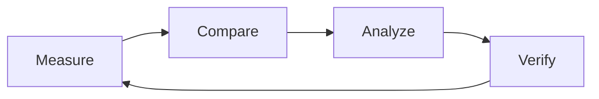

# MoonPerf Lab

**Reproducible performance research for MoonBit.**

MoonPerf Lab is an engineering research platform for the MoonBit ecosystem. It
starts from cross-language performance comparison, and its core value is an
optimization gain you can verify: establishing baselines, running controlled
experiments, locating where MoonBit programs lose time, and proving that a
change actually helps — on another machine, by another person, from the recorded
evidence.

It is not a benchmark collection and not a performance-analysis product. It is
the experiment infrastructure that makes performance claims checkable.

## The loop



## What it answers

- How does a MoonBit program behave under a given workload?
- Where does the gap to a Rust or C reference come from: algorithm, data
  layout, compiler decisions, memory access or runtime overhead?
- Which gaps can be closed by changing the code, the layout or the algorithm?
- Does an optimization replicate on another machine, and is the gain larger
  than the measurement noise?
- Which results can be reused as benchmarks, methods or tools by the rest of
  the MoonBit ecosystem?

The last question is the point of the project. A single ratio between two
languages is not a result; a reproducible experiment that explains it is.

## Scope in three layers

| Layer | What it adds | Horizon |
| --- | --- | --- |
| **L1 · Measurement infrastructure** | Unified workload definitions, run flow, environment capture, result format and a reproduction path: performance data you can trust and repeat. | MVP |
| **L2 · Cross-language research** | The same workload and semantics implemented in MoonBit, Rust and C, so differences can be attributed to algorithms, compilers, memory access and runtime behaviour. | Mid-term |
| **L3 · Optimization and knowledge** | Reusable baselines, regression detection, cross-project adapters and published evidence that turns experiments into optimization practice. | Long-term |

The layers are built in that order on purpose. A comparison is only worth
making once the measurement is trustworthy; an optimization is only worth
reporting once it can be reproduced.

## What it is not

| Not this | Why |
| --- | --- |
| A pile of benchmark results | Numbers without reproducible infrastructure, correctness gates and an optimization loop are not evidence. |
| A Moonlake-only tool | Moonlake is the first real workload and the first dogfooding case, not the boundary of the lab. |
| A language leaderboard | One number per language hides the workload and the measurement conditions. |
| A replacement for profilers | The lab integrates existing profilers and hardware counters instead of building another sampling engine. |
| An "AI that optimizes everything" | Automation can be added incrementally; it cannot replace experimental design and verification. |

## Mission and vision

**Mission.** Make performance measurement in the MoonBit ecosystem
reproducible, performance gaps analyzable and optimization gains verifiable.

**Vision.** A credible, open and sustainable performance research
infrastructure for MoonBit, where optimization moves from intuition to
evidence.

## Design goals

- **Trust.** A result can be reproduced from its artifact by someone who was
  not present when it was produced.
- **Comparability.** The same workload, dataset and measurement rules apply to
  every implementation in a table.
- **Traceability.** Every number links to a commit, a toolchain and a dataset
  hash.
- **Low integration cost.** A new workload or language is a directory, not a
  framework change.
- **Honesty.** The lab can report a loss, a tie or an unstable measurement, and
  it says so explicitly.

## Principles

> Reproducible by default. Comparable by design. Optimizable in practice.

- **Correctness gates performance.** An implementation that produces the wrong
  answer is a bug report, not a fast result. It is never timed, ranked or
  quoted.
- **No predetermined winner.** The lab must be able to report that MoonBit is
  faster, equal or slower. A conclusion that cannot come out either way is
  marketing, not research.
- **Every claim has an artifact.** A result is a JSON file with raw samples,
  environment metadata, the correctness verdict and the command that produced
  it. The Markdown report is generated from that file.
- **Integrate, don't reinvent.** Use the compilers, profilers and counters that
  already exist.
- **Small and honest beats broad and noisy.** One workload measured properly is
  worth more than ten measured carelessly.

## Who it serves

- **MoonBit developers** who want to know how the language, compiler and
  runtime actually behave under real workloads.
- **Library and infrastructure authors** who need to find the bottleneck in a
  key workload and prove that a change helps.
- **MoonBit ecosystem projects** that want to reuse one benchmark and
  comparison method instead of rebuilding their own.
- **Compiler and runtime researchers** who need performance evidence that can
  be reproduced, compared and discussed.

## Status

**P0 is in place.** The experiment protocol, the workload, adapter and result
schemas, the workload skeleton and a harness CLI that validates all of them are
in this repository. The schemas and the CLI are enforced by tests and CI, so
the protocol already has teeth.

**No performance numbers are published yet, and there is no leaderboard.** The
first complete experiment — `numeric-scan` implemented in MoonBit, Rust and C
on a recorded machine — is P1, the next milestone.

What exists today:

- [`docs/experiment-protocol.md`](docs/experiment-protocol.md): the normative
  contract for a measurement, from dataset bytes to result artifact.
- [`schemas/`](schemas/): JSON Schema for workload manifests, adapters and
  result artifacts.
- [`workloads/numeric-scan/`](workloads/numeric-scan/): the first workload,
  specified and waiting for its implementations.
- [`mpf/`](mpf/): the harness package. Today it validates specs; the runner and
  report generator land with P1.

## Repository layout

```
docs/
  experiment-protocol.md   normative protocol: what a valid experiment is
  ROADMAP.md               phases, scope boundaries, acceptance criteria
schemas/
  workload.schema.json     workload.toml contract
  adapter.schema.json      adapter.toml contract
  result.schema.json       experiment result contract
workloads/
  numeric-scan/            the first workload (draft)
mpf/                       harness CLI (list / validate; runner in P1)
tests/                     specification tests (Python unittest)
results/                   committed experiment artifacts (empty until P1)
pyproject.toml             harness package, one runtime dependency
```

## Quick start

Requires Python 3.11+ and [uv](https://docs.astral.sh/uv/). The harness has one
runtime dependency (`jsonschema`); uv installs it into `.venv`.

```bash
uv run mpf list          # workloads, status and discovered implementations
uv run mpf validate      # validate every manifest, adapter and schema
uv run python -m unittest discover -s tests
```

Without uv:

```bash
python3 -m venv .venv
.venv/bin/pip install -e .
.venv/bin/mpf validate
```

## The first experiment: numeric scan

[`workloads/numeric-scan`](workloads/numeric-scan/) streams a dense `f64`
array and accumulates `sum`, `sumsq`, `min`, `max` and a threshold count. It is
the smallest workload that exercises the whole loop: deterministic dataset,
exactly specified output, cheap to implement three times, and sensitive to
compiler decisions.

The experiment is complete when:

1. the same workload runs under MoonBit and at least one Rust or C reference;
2. a deliberately injected error is caught by the correctness gate and
   excluded from timing;
3. repeated runs produce raw samples plus a summary report;
4. changing the commit makes the exact code version of an experiment
   traceable;
5. another developer can reproduce the whole flow from the documentation.

None of these conditions is "MoonBit wins".

## MVP scope

**In the first version:** a command-line runner, one unified adapter interface,
the correctness gate, repeated measurement, JSON and Markdown reports,
experiment metadata and reproduction instructions.

**Deliberately later:** a web dashboard, a database, distributed execution,
automatic parameter search, a plugin system and automatic bottleneck
diagnosis. Those are P3/P4 concerns; adding them earlier would delay the first
trustworthy measurement.

## How a workload lands

1. **Specify it.** Add `workloads/<name>/workload.toml` with dataset, params,
   verification and measurement. Changing any of those means bumping
   `version`; a published version is never edited in place.
2. **Implement it.** Add `implementations/<id>/` with `adapter.toml`,
   `run.sh` and — when the language needs one — `build.sh`. A different build
   profile is a different implementation id, not a hidden flag.
3. **Declare the reference.** `verify.reference` names the implementation used
   as ground truth; tolerance mode needs `rtol`.
4. **Validate and measure.** `mpf validate` must pass; the experiment runs only
   on a recorded machine.
5. **Commit the evidence.** The raw result JSON and the generated Markdown
   report land under `results/`. A result without its environment and
   reproduction command is not accepted.

## Roadmap

| Phase | Outcome |
| --- | --- |
| **P0 · Foundation** | Protocol, schemas, skeleton — *in place* |
| **P1 · MVP** | One complete, reproducible experiment (numeric scan) |
| **P2 · Coverage** | A representative suite: hash join, columnar gather, Parquet decode, end-to-end SQL |
| **P3 · Automation** | CI correctness gates, history and regression detection |
| **P4 · Research** | Profiling, bottleneck attribution, experiment matrices, cross-project adapters |

The full phase plan, scope boundaries and acceptance criteria are in
[`docs/ROADMAP.md`](docs/ROADMAP.md). The rule for the near term is simple:
prove the experiment is trustworthy before adding benchmarks, and close one
optimization loop before building a general platform.

## Moonlake is the first validation case

[Moonlake](https://github.com/superbigcup325/moonlake) is the first project that
uses the lab, and the first source of real data-processing workloads (numeric
scan, hash join, gather, Parquet decode, end-to-end SQL). It is a consumer of
the lab, not its owner: the protocol, the schemas and the harness stay
project-agnostic so other MoonBit projects can adopt them without forking the
framework.

## How success is measured

| Stage | Success means |
| --- | --- |
| MVP | A new benchmark can be added through the documented interface; experiments reproduce; every result is traceable. |
| Research platform | The suite covers representative compute, memory-access and data-processing workloads. |
| Optimization loop | A concrete gap is located and an optimization is verified with an experiment, not an anecdote. |
| Ecosystem infrastructure | External projects integrate, reuse and contribute benchmarks independently. |

The count of benchmarks, or the number of times MoonBit beats Rust or C, is
explicitly not a success metric.

## Contributing

New workloads, new implementations and harness improvements are welcome.
The bar is the same for every contribution:

- the correctness gate must be able to fail — demonstrate that an injected
  error is caught;
- a performance claim must come with a result artifact, not a screenshot;
- generated datasets and local scratch files stay out of version control;
- no result is merged without the environment metadata and reproduction
  command that produced it.

Open an issue with the workload you want to add before writing a large
implementation.

## License

[MIT](LICENSE).
