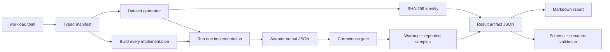

# Architecture

**Status:** target architecture for P1, reviewed 2026-10-20. The runtime still
uses the Python bootstrap described in
[`ROADMAP.md`](ROADMAP.md#current-status); the first MoonBit slice
(`moonperf/core/dataset` and a small CLI) now exists. This document describes
what the repository must become, not what it already is.

MoonPerf Lab is a MoonBit-first experiment framework. The framework core owns
the experiment model, manifests, dataset generation, process orchestration,
correctness, measurement bookkeeping, result artifacts and reports. The
programs under test are separate implementations, usually written in MoonBit,
Rust or C.

This separation is the central design decision:

- **MoonBit owns the experiment.** The framework is a MoonBit program, built
  with the MoonBit toolchain, tested with `moon test`.
- **Other languages own the subjects.** A Rust or C program is an
  implementation of a workload, not part of the framework.
- **The host boundary is small and explicit.** A POSIX process-group utility or
  a tiny native shim may provide an OS primitive that MoonBit does not expose.
  It contains no experiment logic.

See [`implementation-boundaries.md`](implementation-boundaries.md) for the
rules that follow from this decision, and [`mvp.md`](mvp.md) for the first
deliverable.

## Target module map

```
moonperf/                         MoonBit module (created in P1.1; dataset + CLI only)
  moon.mod
  core/
    manifest/                     workload.toml + adapter.toml -> typed model
    dataset/                      generators, .data cache, SHA-256 identity
    host/                         process primitive: spawn, wait, timeout, clock
    verify/                       exact and tolerance correctness gates
    measure/                      warmup, repeats, samples, statistics, CV
    artifact/                     result model, JSON, structural validation
    report/                       Markdown rendered from an artifact
    runner/                       experiment orchestration
  cli/                            mpf list | validate | run | report

host/                             optional native helper, only if utilities are
  mpf-host.c                      not enough (Linux MVP uses setsid/kill)
schemas/                          normative JSON Schema (additive P1 fields allowed)
workloads/                        manifests and implementations under test
tools/legacy-python/              temporary oracle; never on the runtime path
```

The current `mpf/` package is the Python bootstrap. It is useful as a
specification oracle and as a source of test fixtures, but it is not the target
core and must not grow new experiment features. The first MoonBit slice
(`moonperf/core/dataset` plus `moonperf/cli`) already reproduces the dataset
bytes and the golden SHA-256. See
[Migration](#migration-from-the-python-bootstrap).

## Data flow



The JSON artifact is the source of truth. The Markdown report is a pure
function of the artifact. Nothing in the report is typed by hand.

## Capability ownership

| Capability | Target owner | Current owner | May live outside MoonBit? |
| --- | --- | --- | --- |
| Manifest parsing and semantic validation | `moonperf/core/manifest` | `mpf/specs.py` | No |
| Dataset generation and identity | `moonperf/core/dataset` | `mpf/dataset.py` + `moonperf/core/dataset` (parity done) | No |
| Build/run/timeout/exit-code capture | `moonperf/core/host` | `mpf/runner.py` | Only the OS primitive (see boundaries) |
| Correctness gate | `moonperf/core/verify` | `mpf/runner.py` | No |
| Samples, statistics, CV, setup fraction | `moonperf/core/measure` | `mpf/runner.py` | No |
| Result artifact assembly and validation | `moonperf/core/artifact` | `mpf/runner.py` | No (cross-check may be Python) |
| Markdown report | `moonperf/core/report` | `mpf/report.py` | No |
| Experiment orchestration | `moonperf/core/runner` | `mpf/runner.py` | No |
| Workload implementations | `workloads/.../implementations` | MoonBit and Rust drafts | Yes, by definition |
| Schema validation | `moonperf/core/artifact` (targeted) | Python `jsonschema` | Cross-check only |
| Source metadata | git command | Python subprocess | Yes, as an external tool |
| Environment metadata | core + Linux `/proc`/sysfs | Python `platform`/`/proc` | OS reads are host facts |

The acceptance test for "MoonBit-first" is not a line-count ratio. It is this
matrix: every experiment capability is owned by a MoonBit module with tests,
and disabling the non-MoonBit code removes only the workload subjects and the
OS primitive, not the experiment loop. The CLI is a MoonBit native binary; the
runtime path has no Python.

## Verified MoonBit capabilities

The following was probed on 2026-10-20 with `moon 0.1.20261016` /
`moonc v0.10.16+b1a0e846e`, `rustc 1.99.1`, Linux x86_64 (CachyOS). The probe
module was a scratch directory and is not part of the repository. The probe
compiled and ran a small native program, added the dependencies listed below,
and used `pgrep`/`ps` to check for orphan processes after a timeout. "Verified"
means it ran on this host; it is not a guarantee for other platforms or future
toolchain versions.

| Capability | Result | API / dependency | Notes |
| --- | --- | --- | --- |
| Native executable with async entry point | Verified | `async fn main` | Required for `moonbitlang/async` process and fs calls |
| File read/write/exists/mkdir | Verified | `moonbitlang/async/fs` | `read_file`, `write_file`, `mkdir`, `exists` |
| TOML parsing | Verified | `moonbit-community/toml@0.5.0` | Parsed the real `workload.toml`; Apache-2.0; depends on `bobzhang/lexer@0.3.0` |
| JSON parse/serialize | Verified | `moonbitlang/core/json` | Parsed an object and re-serialized it |
| Monotonic wall clock | Verified | `moonbitlang/core/bench` | `monotonic_clock_start()` / `monotonic_clock_end(ts)` return microseconds; 10 ms sleep measured 10.1 ms |
| Spawn child, wait, exit code | Verified | `moonbitlang/async/process` | `spawn_orphan` + `wait_pid`; exit code 3 observed |
| Timeout with cancellation | Verified | `@async.with_timeout_opt` | 300 ms timeout returned `None` at ~301 ms |
| Capture stdout/stderr | Verified | `@process.redirect_to_file` | File capture worked; create a fresh redirect per invocation |
| Process-group timeout | **Not provided by MoonBit** | `setsid -w` + `kill -KILL -<pid>` | Direct async timeout leaves grandchildren alive (two `sleep` processes survived a 300 ms timeout). The `setsid` wrapper made PID = PGID = SID; `kill -KILL -- -<pid>` killed the whole group. |
| SHA-256 | Verified | `moonbitlang/x/crypto` | `@crypto.sha256` + `bytes_to_hex_string`; the 1M-element numeric-scan dataset matches `fa4970…` |
| JSON Schema validation | **Not yet verified** | Candidate packages only | `colmugx/json-schema`, `moonbitstack/moonschema`; a targeted validator plus a Python cross-check is the fallback |
| Async concurrency / task groups | API present; not used for measurement | `@async.with_task_group` | Parallel samples would contend for CPU, memory and caches; the MVP runs samples sequentially |
| Cross-platform | Linux x86_64 verified only | — | macOS, Windows and wasm are not verified; see the platform matrix in `implementation-boundaries.md` |
| Windows/macOS process groups | **Not verified** | — | `setsid` is Linux util-linux; macOS needs a native shim or another primitive |

The process-group gap is the most important finding. A timeout that kills only
the direct child can leave a compiler or a runaway adapter running during the
next sample, silently contaminating the measurement. The MVP must kill the
whole process group. Community process packages were considered and do not
solve it: `moonbit-community/proton_process` exposes `kill` for the direct
child, not a process group, so it would leave the same orphan. The verified
Linux MVP mechanism is a wrapper:

```text
setsid -w <adapter run.sh ...>
```

with a harness-side `kill -KILL -<pid>` on timeout. This is a host utility
boundary, not experiment logic. A small POSIX C shim is the fallback if the
utility is unavailable or if macOS support is added; it would expose only
spawn/wait/kill-group/clock and would contain no manifest, measurement or
report code.

Other verified constraints:

- `moonbitlang/async` is officially published but explicitly experimental;
  pin the version and treat API churn as a known risk.
- The library states native/LLVM support on Linux and macOS. The harness is a
  native CLI; wasm/JS is not a supported harness target in the MVP.
- `@env.now()` is wall-clock milliseconds and is not a monotonic measurement
  clock. Use `@bench` for elapsed time.
- There is no process-group API in the standard library or in
  `moonbitlang/async`. Signal handling exists (`moonbitlang/async/signal`), but
  it is not a process-group primitive. Do not assume one.

## Interfaces

### 1. Manifest to model

`moonperf/core/manifest` reads `workload.toml` and every
`implementations/<id>/adapter.toml`, applies the JSON Schema plus the semantic
rules (`verify.reference` exists, scripts are executable, name matches
directory), and returns typed values. The runner receives typed values; it does
not walk TOML maps or re-parse strings.

The TOML parser returns typed values; a small converter maps them to the core
value type. The schemas are closed and small, so a targeted validator is
acceptable; the Python `jsonschema` run is the independent oracle. A general
MoonBit JSON Schema library is optional if it passes the repository cases.

Errors are reported as a list of `path: message` strings, matching the current
`mpf validate` behavior. One invalid file must not abort validation of the
others.

### 2. Host primitive

The host primitive is the only place that starts a child process. Its contract:

```text
run(command, args, cwd, timeout_ms, stdout_path, stderr_path)
  -> { exit_code, timed_out, wall_us }
```

- The child runs in its own process group/session.
- On timeout, the whole group is killed and the child is reaped; the call
  returns `timed_out = true`. A timeout must not leave a zombie.
- stdout and stderr go to files; the harness reads them after the timed region.
- `wall_us` is the harness's monotonic measurement around spawn and wait.
- The primitive does not know about workloads, manifests, verification or
  reports.

The Linux MVP implementation is `setsid -w` plus `kill -KILL -<pid>`; the
MoonBit code still owns the call sequence, timeout policy and result handling.
A native shim may replace it without changing this contract.

### 3. Adapter contract

Unchanged from [`experiment-protocol.md`](experiment-protocol.md#5-adapter-interface),
with one P1 addition:

```text
run.sh --input <dataset> --params <params> --output <json> --repeat <K>
```

`K >= 1` runs the kernel `K` times. `K = 0` is the **setup baseline**: the
adapter loads the input and exits successfully without running the kernel; the
harness times this invocation but does not verify its output. The setup
baseline measures process startup, dataset loading and any input conversion.
It is recorded, not subtracted. Adapters must support `K = 0`; a missing or
failing baseline makes the setup diagnostic unavailable, which is recorded in
the artifact.

The adapter owns input loading, the kernel and its output serialization. It does
not own timing, comparison, statistics or reporting.

### 4. Artifact

The artifact is the JSON document described by
[`schemas/result.schema.json`](../schemas/result.schema.json). P1 changes two
things:

- `experiment.harness` becomes language-neutral: required `name` and `version`,
  optional `runtime`; the legacy `python` field becomes optional and is not
  written by the MoonBit core. Old artifacts remain readable under
  `schema_version = 1`; new artifacts do not depend on Python.
- Each `implementations[]` entry gains an optional `setup` object with
  `inner_repeats = 0`, `wall_ns`, and `fraction`. It is per implementation,
  because process startup and input loading differ by language and runtime. The
  comparison metric stays the per-iteration wall time of the measured run.

The artifact is validated structurally by the MoonBit core and, during the
transition, independently by the Python `jsonschema` tool. A disagreement
between the two validators is a bug in the MoonBit validator (or in the
schema), not a result.

### 5. Report

`moonperf/core/report` is a pure function `artifact -> Markdown`. It never
measures, never fills a missing number and never reads a workload
implementation. Regenerating a report from the same artifact produces the same
document.

## Measurement model

The harness owns the clock. The timed region is one child process invocation:

1. The harness starts the child with `--repeat K` and a timeout.
2. The child starts, loads the dataset, runs the kernel `K` times and writes its
   output.
3. The harness stops the clock when the child exits.

The per-iteration sample is `wall_ns / K`. It includes process startup, dataset
loading and `K` kernel passes. Those costs are identical in contract for every
implementation in the same experiment; they are not hidden.

To keep the comparison about the kernel, the harness also runs a setup baseline
with `K = 0`, records `setup_ns`, and reports:

```text
setup_fraction = setup_ns / wall_ns(K)
```

For a micro tier claim, `setup_fraction` must be at most 0.10. If it is larger,
the harness records the fact and the experiment is labelled as
`setup-dominated`; it may still be a valid artifact, but it is not evidence for
a kernel comparison. `K` is chosen from a pilot run so that the kernel
dominates: increase `K` until `setup_fraction` is small enough, then keep that
value in the manifest.

Why this model:

- The harness owns the clock; an adapter cannot report a flattering number.
- The timer is monotonic and measured outside the child.
- No subtraction is used, so load noise is not amplified by subtracting two
  large numbers; `K` amortizes the constant instead.
- The setup baseline is reported rather than silently excluded.
- Correctness is checked in a separate invocation, so the correctness run
  cannot affect the measured sample.

The model deliberately does **not** measure inside the adapter and does not
subtract a calibrated constant in P1. Adapter-internal timing is a P3 research
option, not an MVP dependency.

## Migration from the Python bootstrap

The Python code is not thrown away and is not extended:

| Step | Action | Gate |
| --- | --- | --- |
| M0 | Freeze `mpf/` except for two blocking oracle fixes (path resolution, reference-first correctness). | One green oracle artifact, or a documented host-instability verdict. |
| M1 | Port pure functions to MoonBit: manifest model, dataset generator, SHA-256, statistics, artifact model, report. | Golden tests: same dataset bytes, same summary from a fixture, byte-identical report from a fixture artifact. |
| M2 | Port the host primitive and runner orchestration. | MoonBit and Python produce comparable artifacts from the same manifest on the same host. |
| M3 | Switch the CLI to MoonBit; keep Python only under `tools/legacy-python/` for schema cross-checks. | An experiment runs with Python absent from `PATH`. |

No step is a big-bang rewrite. Each step has a contract test against the
previous implementation. When M3 is complete, the Python harness is a test
oracle, not a runtime component.

## Architecture decisions

| ID | Decision | Rationale | Revisit when |
| --- | --- | --- | --- |
| ADR-001 | The framework core is MoonBit; Python is a temporary oracle. | Hackathon rule: MoonBit is the primary implementation language. The framework, not the subjects, must be MoonBit. | Never; this is the positioning. |
| ADR-002 | MVP reference language is Rust; C is P2. | The workload is already implemented and the protocol only requires one reference. C adds toolchain and fairness work without adding MVP evidence. | P2, when a C reference is useful for compiler comparison. |
| ADR-003 | Numeric Scan is the first workload. | Smallest complete loop; deterministic dataset; exact/tolerant output; exposes compiler and memory-access differences. | Never for MVP; it is the calibration workload. |
| ADR-004 | The harness owns wall-clock timing; adapters do not report time. | Removes an incentive and a contract burden; keeps one clock and one definition. | P3, if adapter-internal timing is needed for a specific question. |
| ADR-005 | Linux MVP kills the whole process group via `setsid -w` and `kill`. | Verified; prevents orphan processes; no native shim needed. | If macOS or a utility-free environment is required. |
| ADR-006 | No database, dashboard, distributed execution or auto-diagnosis in MVP. | They do not make the first measurement more trustworthy. | P3/P4 with a concrete use case. |
| ADR-007 | Keep the TOML manifest format; protocol v1 remains the baseline, with additive P1 fields. | Existing decisions are sound; changing the format would invalidate the protocol and the schemas without evidence. | Protocol v2 only for a semantic gap, not for an additive diagnostic. |
| ADR-008 | No line-count target for "MoonBit-first". | Line counting rewards padding. Capability ownership and tests are the evidence. | Never. |
| ADR-009 | Pinned third-party MoonBit libraries are allowed for parsing and hashing; no Python runtime. | Reinventing a TOML parser or SHA-256 is not the research contribution; pinning and testing is cheaper. | If a dependency is unmaintained, license-incompatible or too large. |
| ADR-010 | The result schema becomes language-neutral. | A required `python` field contradicts MoonBit-first. | When `schema_version` changes. |

## Open questions for P1 spikes

1. **SHA-256:** resolved for P1. The MoonBit core uses
   `moonbitlang/x/crypto` and passes the 1M-element golden hash. Keep the test
   as the guard if the dependency changes.
2. **JSON Schema validation:** a general MoonBit validator or a targeted
   validator for the three repository schemas plus a Python cross-check.
   Prefer the targeted validator if the schemas stay closed and simple.
3. **TOML parser:** `moonbit-community/toml` parsed the real manifest and the
   MoonBit CLI uses it. Still add malformed-input tests and a restricted-parser
   fallback only if the dependency is rejected.
4. **Process group on macOS:** `setsid` is not available; a native shim or a
   different primitive is required. The MVP is Linux-only, so this is a P2
   decision.
5. **JSON float formatting:** confirm that MoonBit's JSON serialization emits
   round-trippable doubles and integers of the right JSON type. Golden tests
   are required before an artifact is accepted.
6. **Host profile:** a laptop on `powersave` produced CV 7.57 % at `K = 10` in
   the current smoke run. A controlled host profile (performance governor,
   no competing load) is a prerequisite for a valid MVP artifact.
